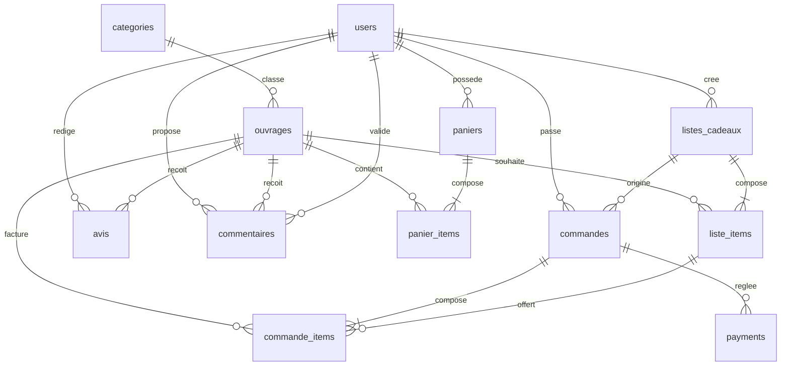

# Schéma de données — livresgourmands.net

Moteur visé : MySQL / MariaDB, InnoDB, `utf8mb4`. Le script exécutable est `sql/schema.sql`.

## Modèle relationnel

Cardinalités utiles : un client a zéro ou plusieurs paniers historisés mais au plus un panier `actif` à la fois (garanti par la transaction applicative). Une commande a au moins une ligne. Un paiement 0..1 courant, plusieurs tentatives possibles. Une liste est consultée par code, sans compte. `commandes.client_id` est nul quand l’acheteur est un ami non inscrit.

## Dictionnaire

### users

| Colonne | Type | Contraintes |
| --- | --- | --- |
| id | INT | PK, auto-incrément |
| nom, prenom | VARCHAR(100) | NOT NULL |
| email | VARCHAR(255) | UNIQUE, NOT NULL |
| password_hash | VARCHAR(255) | NOT NULL, bcrypt |
| role | ENUM client, editeur, gestionnaire, administrateur | défaut client |
| actif | BOOLEAN | défaut vrai (RG5) |
| created_at, updated_at | DATETIME | NOT NULL |

### categories

| Colonne | Type | Contraintes |
| --- | --- | --- |
| id | INT | PK |
| nom | VARCHAR(120) | UNIQUE, NOT NULL |
| description | TEXT | nullable |

### ouvrages

| Colonne | Type | Contraintes |
| --- | --- | --- |
| id | INT | PK |
| titre, auteur | VARCHAR(255) | NOT NULL |
| isbn | VARCHAR(20) | UNIQUE, NOT NULL |
| description | TEXT | nullable |
| prix | DECIMAL(10,2) | CHECK >= 0 |
| stock | INT | CHECK >= 0, index (RG1) |
| popularite | INT | CHECK >= 0, index |
| categorie_id | INT | FK → categories.id, index |

### paniers / panier_items

| Colonne | Type | Contraintes |
| --- | --- | --- |
| paniers.client_id | INT | FK → users.id, index (client_id, actif) |
| paniers.actif | BOOLEAN | défaut vrai |
| paniers.updated_at | DATETIME | sert à RG2 |
| panier_items.quantite | INT | CHECK > 0 |
| panier_items.prix_unitaire | DECIMAL(10,2) | prix au moment de l’ajout |
| | | UNIQUE (panier_id, ouvrage_id) |

### listes_cadeaux / liste_items

| Colonne | Type | Contraintes |
| --- | --- | --- |
| nom | VARCHAR(200) | NOT NULL |
| proprietaire_id | INT | FK → users.id |
| code_partage | VARCHAR(32) | UNIQUE |
| quantite_souhaitee | INT | CHECK > 0 |
| quantite_achetee | INT | CHECK >= 0, défaut 0 |
| | | UNIQUE (liste_id, ouvrage_id) |

### commandes / commande_items

| Colonne | Type | Contraintes |
| --- | --- | --- |
| client_id | INT | FK, NULL si ami sans compte |
| liste_cadeaux_id | INT | FK, NULL si la commande vient du panier |
| acheteur_nom, acheteur_email | VARCHAR | NOT NULL |
| total | DECIMAL(10,2) | CHECK >= 0 |
| statut | ENUM | en_attente_paiement, payee, en_preparation, expediee, livree, annulee |
| adresse_livraison | TEXT | NOT NULL |
| mode_livraison | ENUM | standard, express, relais |
| mode_paiement | ENUM | carte_simulee, paypal_simule |
| commande_items.prix_unitaire | DECIMAL(10,2) | instantané |
| commande_items.liste_item_id | INT | FK nullable |

Index : client, statut, date, liste.

### avis

| Colonne | Type | Contraintes |
| --- | --- | --- |
| client_id, ouvrage_id | INT | FK, UNIQUE ensemble (RG3) |
| note | INT | CHECK 1..5 |
| date_avis | DATE | NOT NULL |

### commentaires

| Colonne | Type | Contraintes |
| --- | --- | --- |
| contenu | TEXT | NOT NULL |
| statut | ENUM | en_attente, valide, rejete, défaut en_attente (RG4) |
| date_soumission | DATETIME | NOT NULL |
| date_validation | DATETIME | NULL |
| valide_par | INT | FK → users.id, NULL |

Index (ouvrage_id, statut).

### payments

| Colonne | Type | Contraintes |
| --- | --- | --- |
| commande_id | INT | FK |
| provider | VARCHAR(40) | simulation_carte ou simulation_paypal |
| provider_payment_id | VARCHAR(80) | UNIQUE, seule référence prestataire (RG6) |
| statut | ENUM | initie, reussi, echoue, annule |
| amount | DECIMAL(10,2) | CHECK >= 0 |

Aucune colonne de carte, de CVV ou d’IBAN.
